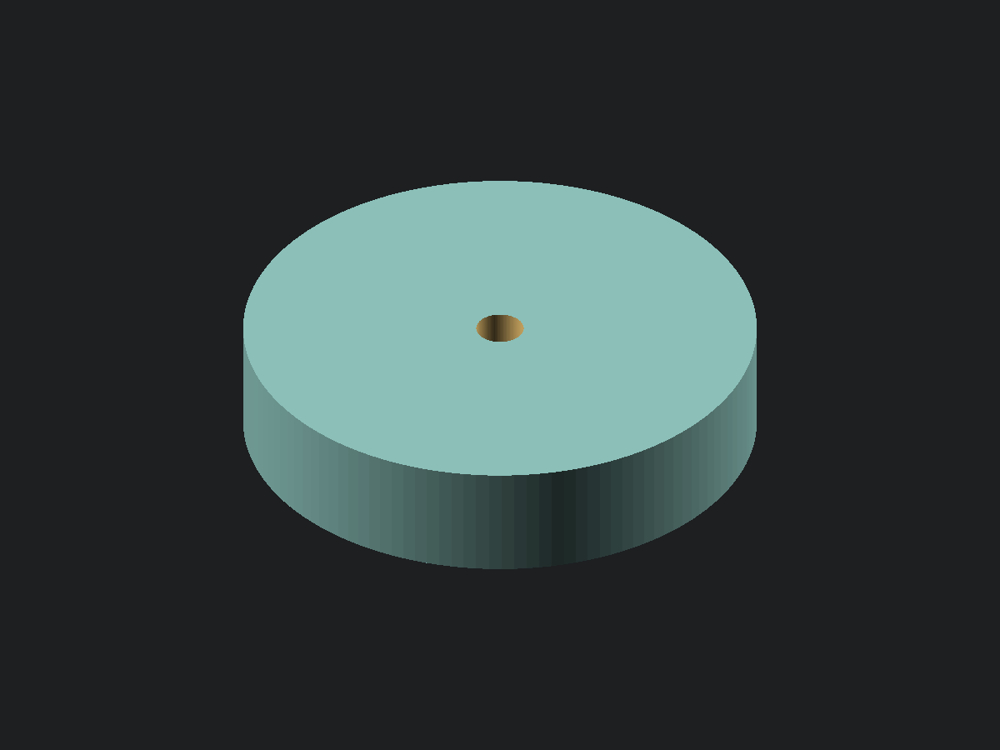

<!-- SPDX-License-Identifier: CC-BY-4.0 -->

# Adhesive mounting disc

[View or download STL](adhesive_mounting_disc.stl) · [OpenSCAD source](adhesive_mounting_disc.scad)

A printed disc with a flat adhesive face and a concentric blind pilot bore on the opposite face. An
adhesive disc sticks it to the back of a TV; a screw through an openGrid tile bites into the printed
plastic. No screw goes into the TV and no heat-set insert is used. It is similar to the
[round washer](../round_washer/README.md), with a closed bottom instead of a through bore.

All dimensions are in millimetres. The supplied values are **examples**, pending the actual adhesive
discs, screws, and tile geometry. See [openGrid notes](../OPENGRID.md) for the system.

## Measurements and tuning

| Measured parameter       | Default | Measure                               | Caliper |
| ------------------------ | ------- | ------------------------------------- | ------- |
| `adhesive_disc_diameter` | 25 mm   | Outside jaws across the adhesive disc | 6 in    |
| `screw_diameter`         | 3 mm    | Outside jaws over the screw threads   | 6 in    |

| Tuning parameter  | Default | Meaning                                                      |
| ----------------- | ------- | ------------------------------------------------------------ |
| `adhesive_margin` | 1 mm    | Extra printed radius beyond the adhesive on each side        |
| `bore_diameter`   | 2.5 mm  | Nominal pilot diameter; no automatic fit allowance           |
| `bore_depth`      | 5 mm    | Distance from the open face to the flat bore floor           |
| `floor_thickness` | 1 mm    | Solid plastic below the bore; values below 1 mm are rejected |
| `$fn`             | 128     | Circular resolution                                          |

The outside diameter is `adhesive_disc_diameter + 2 * adhesive_margin`: **27 mm** with the defaults.
Total thickness is `bore_depth + floor_thickness`: **6 mm** with the defaults. Increasing bore depth
increases total thickness rather than thinning the floor. The source echoes these derived values,
the pilot dimensions, floor thickness, and radial material remaining outside the screw threads.

Assertions reject nonpositive adhesive diameter, margin, bore diameter, or bore depth; a pilot
diameter at least as large as the screw; an outside diameter no larger than the screw; and a floor
below 1 mm. The cut starts exactly at the top of the floor and extends beyond only the open face.
There is no recess in the adhesive face, chamfer, countersink, or printed thread.

Choose the pilot diameter for the actual plastic screw, material, and printer. Smaller than the
thread diameter leaves material for the threads to bite, but the example 0.5 mm difference is not a
validated fit. Use the screw maker's pilot guidance where available and test one disc before a
batch.

## Screw reach and assembly

**The 1 mm floor is a model constraint, not a screw stop.** A self-drilling tip can pierce it. With
the actual screw seated in the actual tile's mounting hole, measure its full projection beyond the
tile's rear mounting face, including the tip, with a 6 in caliper. That projection must be shorter
than `bore_depth`, with clearance for seating and measurement variation. A countersunk head can seat
deeper than expected, so use the tile's actual seated position rather than subtracting its nominal
thickness from a screw length. Increase bore depth or choose a shorter screw if necessary. Do not
count the floor or adhesive thickness as usable screw depth.

Check that the chosen disc diameter fits behind the selected tile holes without colliding with
neighbouring discs, tile ribs, or required snap space. The disc has no grid features or spacing
constraint; compatibility depends on the tile generator and hole positions you choose.

Trial-fit the screw and tile on a loose disc before applying adhesive. Check fit and full tip reach,
then use the adhesive maker's surface-preparation and curing instructions. Confirm the selected
adhesive and printed material suit the TV's rear surface and operating temperature, and keep vents
clear. Adhesion, screw retention, and load capacity need physical testing with the actual hardware.

## Printing and verification

Print as modelled: the full flat adhesive face on the plate, blind bore opening upward. Its floor is
built directly on earlier layers, so there is no bore ceiling to bridge. All inner and outer walls
are vertical (0° from vertical); the only downward-facing face is on the plate. No supports are
needed. Use slicer settings that leave the chosen floor thickness solid and retain a flat adhesive
face.

The example dimensions have not been physically printed or fit-tested. A 1 mm minimum preserves a
closed model; its suitability for the chosen screw and load remains untested.

Geometry verified on 2026-11-06: the default export reported manifold `Status: NoError`; its mesh
was closed with no overhangs past 45°. Scratch renders also checked a 10 mm bore depth, a 2 mm
floor, and a 40 mm adhesive disc. Mesh dimensions, bore-floor height and area, and volume matched
the intended blind-bore geometry in all four cases. Floors of 0.99, 0, and -1 mm were rejected,
along with zero bore depth, zero bore diameter, a pilot equal to the screw diameter, zero adhesive
diameter, zero margin, and a screw as wide as the printed disc.
