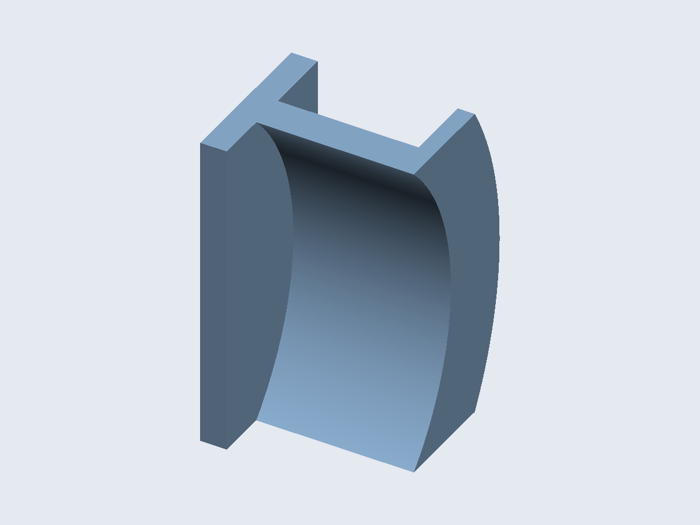

<!-- SPDX-License-Identifier: CC-BY-4.0 -->

# openConnect cable saddle

[](openconnect_cable_saddle.stl)

[STL](openconnect_cable_saddle.stl) · [OpenSCAD source](openconnect_cable_saddle.scad)

A wall hook for a coiled cable, shaped like a garden hose hanger at a smaller scale. A curved saddle
stands out from a back plate; the coil drapes over it with the plate behind and a lip in front, so
it cannot slide off either way. The back plate is two openGrid tiles wide and carries openConnect
slots.

The shipped values are for the Ethernet coil that runs to the Apple TV, **taken from memory**: 100
mm inside and 20 mm thick. Measure it before printing. A 100 mm coil is close to the smallest this
plate width allows; see [Measure and tune](#measure-and-tune).

The preview shows it as it prints, on its side. Hung on the wall, the plate is vertical, the
saddle's curve rises to a crown just under the plate's top edge, and the coil hangs down in front of
the plate.

## Hanging it

Fit openConnect connectors to the board under both slots. Hold the saddle a little high so the lower
ends of its slots sit over the connectors, push it flat against the board, and slide it down until
the locks click. Lift it to take it off.

## Measure and tune

All dimensions are millimetres.

| Input            | Where to measure                                                   | Caliper |
| ---------------- | ------------------------------------------------------------------ | ------- |
| `coil_inner_d`   | Inside jaws across the coil's opening, across the loop it hangs by | 6 in    |
| `coil_thickness` | Outside jaws across the coiled bundle                              | 6 in    |

A coil hangs into a teardrop rather than a circle, so measure the top loop, which is the part that
rests on the saddle.

`saddle_clearance` makes the saddle's radius that much smaller than the coil's inside radius, so the
coil drops on without being forced round it. The default of 5 mm gives a 45 mm saddle radius.
`depth_clearance` is the room left beyond the coil's thickness between the plate and the lip, which
gives a 25 mm channel by default. `lip_height` is how far the lip stands above the saddle, and
`band_thickness` is the saddle's own thickness.

**The coil's inside diameter has a floor.** Printed on its side, the saddle's inner face hangs
steepest at the upper wing tip. It hangs at the angle whose sine is half the plate's width over the
saddle's inner radius, so that radius has to be at least the half-width times √2. On a two-tile
plate that is 39.6 mm, which with the default clearance and band thickness means a coil at least
99.2 mm inside. The shipped 100 mm coil clears it by less than a millimetre. For a smaller coil,
reduce `saddle_clearance` or `band_thickness`, or narrow the plate. An assertion stops the render if
the wings would hang past 45°, so a coil too tight for the plate fails the render rather than the
print. The render `echo`s both wing-tip angles.

`plate_tiles_across` and `plate_tiles_up` set the back plate in openGrid tiles. The slot grid is as
many slots as fit with `wall_thickness` clear all round, centred, which is two side by side on the
default plate. Both carry lock nubs. `slot_side_clearance` and `slot_depth_clearance` are the slot's
fit, as mitufy's generator ships it.

## The openConnect slot

The slot is mitufy's openConnect slot, rebuilt in plain OpenSCAD from
[`lib/openconnect_lib.scad`](https://github.com/mitufy/opengrid-projects/blob/main/lib/openconnect_lib.scad),
CC BY 4.0, the same reconstruction as the
[openConnect item holder](../openconnect_item_holder/README.md). With its changes turned off it
matches the generator's to 0.03 mm³ in 1,010. Nothing here derives from mitufy's own hooks and
holders, which are CC BY-SA 4.0.

The changes differ from the item holder's, because this slot prints on its side, not upright. A
sideways slot has two flat ceilings, both on its upper side, away from the lock nub. Both are turned
to 45°, and neither touches the connector:

- **The flange bevel.** The pocket the connector's flange slides in has square sides, so its upper
  side is a ceiling 0.74 mm deep. Here the 45° taper above it runs on down to the slot's floor. The
  extra room is beyond the flange's edge, and the taper the flange bears on is unchanged.
- **The mouth flare.** Where the slot opens through the back face, its upper edge is a flat ledge
  0.8 mm deep. Here it is cut back at 45° toward the face. The connector's neck never reaches it.

See [OPENGRID.md](../OPENGRID.md#openconnect-slots) for the slot's dimensions and why each
orientation needs its own fixes.

## Printing

Print as modelled, on its side, no supports. It stands on the end of one wing and the edge of the
plate, 56 mm tall on a narrow footprint, so get the first layer well squished or add a brim. The
worst overhang is 45°: the slot's tapers and chamfers, the bevel and flare, and the saddle's faces
at the wing tips. The lock nubs sit on the lower wall of each slot, as mitufy recommends for slots
printed on their side.

This way up, the layer lines run along the arm, out from the wall. The coil's weight bends the arm
where it leaves the plate, and that stress then runs within each layer rather than pulling layers
apart. Printed as it hangs, the underside of the saddle's crown would be a flat ceiling. Printed
plate-down, the arm's root would run across the layer lines.

Not yet printed, so the slot fit on your connectors and the arm's stiffness are both untested. PETG
suits it, as it does the connectors.

Rebuild the STL and preview after changing parameters:

```sh
scadformat openconnect_cable_saddle/openconnect_cable_saddle.scad
.venv/bin/python scripts/build.py openconnect_cable_saddle/openconnect_cable_saddle.scad
```
