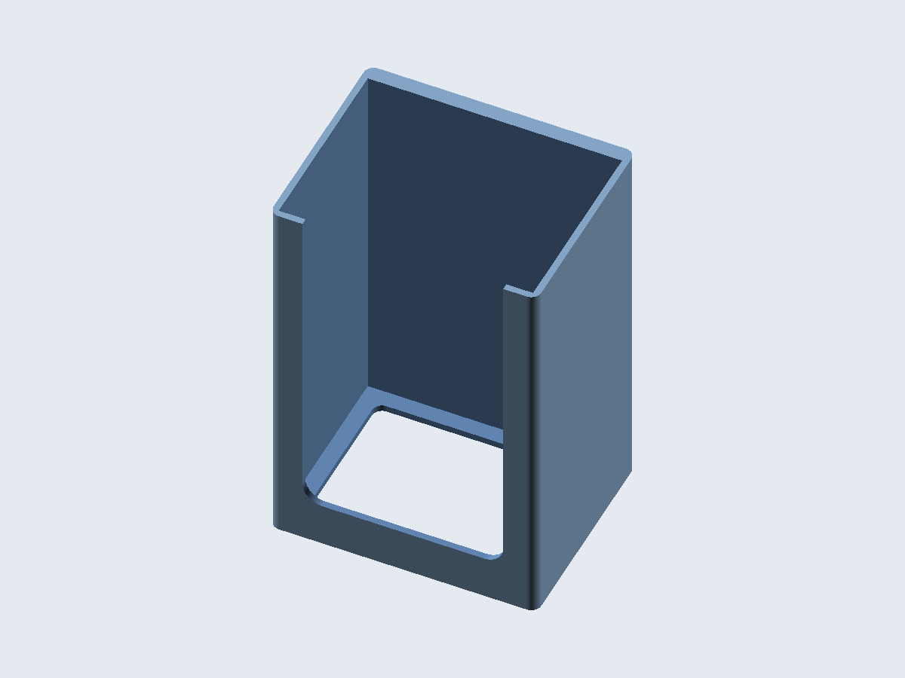

<!-- SPDX-License-Identifier: CC-BY-4.0 -->

# openConnect item holder

[](openconnect_item_holder.stl)

[STL](openconnect_item_holder.stl) · [OpenSCAD source](openconnect_item_holder.scad)

An open-topped box that hangs a device on an openGrid board. The device drops in from the top and
stands on a lip around a hole in the floor. The hole lets a cord out underneath, and the lip stops
the device sliding out through it. A cut down the front leaves the device's face and ports
reachable. It keeps a strip of wall at the bottom and at each side, so the device cannot tip out
forward.

The back carries a grid of [openConnect](https://www.printables.com/model/1559478) slots, mitufy's
connector system for openGrid. Nothing here uses Multiboard, Multiconnect or Multipoint.

The shipped values fit a SABRENT VOLTIK charging station.

## Hanging it

Fit openConnect connectors to the board where the holder is to go. Hold the holder a little high so
the lower ends of its slots sit over the connectors, then push it flat against the board and slide
it down. The connectors run up their tracks into the seats at the top, and the corner slots click as
their lock nubs pass. Lift it to take it off.

Every slot holds whether or not it has a lock. With the defaults the back carries a 2 × 4 grid, but
the holder only needs connectors under as many slots as its load calls for.

## Measure and tune

All dimensions are millimetres. The three inputs are outside dimensions of the device:

| Input         | Where to measure                                                   | Caliper |
| ------------- | ------------------------------------------------------------------ | ------- |
| `item_width`  | Side to side                                                       | 6 in    |
| `item_depth`  | Front to back, over rubber feet or anything else proud of the back | 6 in    |
| `item_height` | Bottom to top                                                      | 6 in    |

Close the jaws gently on rubber feet. They squash, and a firm reading comes out short.

`width_clearance` and `depth_clearance` are added to the measured width and depth to make the
pocket. They are totals, not per side. A pocket prints slightly under size, so zero is a press fit.
The defaults are 1 mm on the width and 2 mm on the depth; the extra depth is for the charging
station's rubber feet, which grip the back wall as the device slides in. For a device with a plain
back, 1 mm on both is a normal drop-in fit.

`rim_drop` lowers the walls below the top of the device. At zero the rim is level with its top.

`bottom_lip` is how far the floor reaches in from each wall around the hole. That ledge is what the
device stands on, so make it wider for a device with rounded bottom edges. `front_side_lip` and
`front_lip_height` are the strips of front wall left standing at the sides of the front opening and
below it. `bottom_opening` and `front_opening` turn either cut off.

`lock_every_slot` puts a lock nub in every slot instead of only the corner ones. More locks hold
tighter and make the holder harder to fit. `slot_side_clearance` and `slot_depth_clearance` are the
openConnect slot's fit, as mitufy's generator ships it. Raise them if the slots are tight on your
printer.

The rest follows. The back wall is the 2.7 mm slot depth plus `wall_thickness`. The slot grid is as
many 28 mm cells as fit on the flat of the back, centred, keeping `wall_thickness` clear of the
edges and the rounded corners. With the defaults the pocket is 76 × 57 × 116 mm, the body is 80 ×
63.7 × 118 mm, and the floor opening is 66 × 47 mm. The render `echo`s these, and assertions catch a
lip that leaves no hole, an opening that leaves no wall, and a back too small for one slot.

For another device, override the inputs rather than editing the file. The Ezcoo EZ-EX50 USB extender
the holder was also wanted for comes out at 63 × 30.1 × 55.5 mm, with a single slot:

```sh
/Applications/OpenSCAD.app/Contents/MacOS/OpenSCAD -o ezcoo.stl \
  -D item_width=58 -D item_depth=22.4 -D item_height=53.5 -D depth_clearance=1 \
  openconnect_item_holder/openconnect_item_holder.scad
```

## The openConnect slot

The slot is not original work. It is rebuilt in plain OpenSCAD from mitufy's openConnect library,
`lib/openconnect_lib.scad` in [opengrid-projects](https://github.com/mitufy/opengrid-projects), CC
BY 4.0, so this file can stand alone like every other source here. The numbers in the source's
openConnect interface block are that standard, not tuning knobs. With both departures below turned
off, the rebuilt slot agrees with the generator's to 0.03 mm³ in 1,010. The holder body owes nothing
to mitufy's own holders, which are CC BY-SA 4.0. See [OPENGRID.md](../OPENGRID.md#openconnect-slots)
for the slot's dimensions, its licensing, and the check against the generator.

The slot stands upright in this part, and the library's slot then has two flat ceilings. Both are
changed, and neither change touches the connector:

- **The seat roof.** The pocket the connector's flange rests in is flat across the top between two
  45° chamfers, a 9 mm ceiling. Here the chamfers run on until they meet in a point. The flange then
  seats on the chamfers instead of the flat, 0.04 mm higher and centred by them.
- **The mouth lead-in.** Where the slot opens through the back face, the top edge of the opening is
  a flat ledge 0.8 mm deep and 7.4 mm wide. Here it is cut back at 45° toward the back face. The
  connector's neck never reaches that edge, and the 45° face the flange bears on below it is
  unchanged.

## Printing

Print as modelled: floor on the plate, opening up, no supports. The worst overhang is 45°, on the
slot chamfers, the seat roof and the mouth lead-in. Every other face is vertical or faces up. The
lip is part of the floor, so it prints flat on the plate.

Not yet printed. The rebuilt slot matches the generator's, but its fit on real connectors from your
printer is untested, and so is the 2 mm wall behind the slots under the device's weight. A one-slot
test cup is quick to print and checks the slot alone:

```sh
/Applications/OpenSCAD.app/Contents/MacOS/OpenSCAD -o slot-test.stl \
  -D item_width=32 -D item_depth=6 -D item_height=30 \
  -D bottom_opening=false -D front_opening=false \
  openconnect_item_holder/openconnect_item_holder.scad
```

Rebuild the STL and preview after changing parameters:

```sh
scadformat openconnect_item_holder/openconnect_item_holder.scad
.venv/bin/python scripts/build.py openconnect_item_holder/openconnect_item_holder.scad
```
