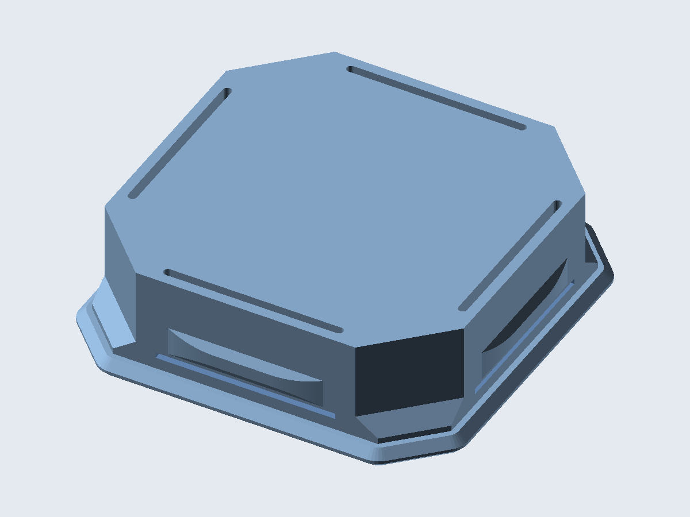

<!-- SPDX-License-Identifier: CC-BY-4.0 -->

# openGrid adhesive snap

[View or download STL](opengrid_adhesive_snap.stl) · [OpenSCAD source](opengrid_adhesive_snap.scad)

A full-thickness openGrid snap with nothing on its front but a flat face for a double-sided adhesive
dot, so a small light object can be stuck to any cell of a board. It exists to hold the remote
clicker for an HDMI KVM under the edge of a desk, where the openGrid tile is mounted and the clicker
stays in reach.

Adhesive snaps already exist for the back of a board, sticking the tile to a wall. Those never need
to come out from the front: the tile pulls off the wall instead. A snap on the front of a mounted
tile has no such escape, and a fully flush one leaves nothing to get hold of.

## Getting it out again

**A thin lip on the front face is the handle.** The lip is wider than the snap, so it lands on the
tile face around the cell, and its tile-side edge is bevelled at 45°. That bevel leaves a V between
lip and tile all the way round. Slip a small flat screwdriver or a fingernail into it and lever
against the tile face, and the snap tips out. Peel the dot off the object first, or pull the object
straight off and the snap may come with it.

The lip was chosen over a notch cut into a flush snap. mitufy's generator has one
(`uninstall_notch_width`), a hook pocket in one edge of the front face, but the relief slot that
frees each arm starts 0.7 mm in from the edge and the pocket reaches 1.8 mm, into the arm. Printed
face down, its roof is also a flat ledge. The lip sits entirely outside the snap, so the arms,
slots, groove and ears are the standard profile untouched, and printed face down nothing on it
hangs.

It also sets the depth: the lip lands on the tile exactly when the snap is fully home. What it costs
is `lip_thickness` of protrusion, which is less than it sounds next to a foam dot that already
stands about 1 mm off whatever it is on.

## Measuring

| Parameter | Measure                               | Caliper |
| --------- | ------------------------------------- | ------- |
| `tape_d`  | Outside jaws across the dot, liner on | 6 in    |

`tape_d` changes no geometry. It is checked against the flat of the tape face, inside the bed
chamfer, and the render fails if the dot would hang over the edge. The echoed margin says how much
room is left.

## Tuning

| Parameter           | What it does                                                      |
| ------------------- | ----------------------------------------------------------------- |
| `lip_thickness`     | How far the lip stands proud of the tile                          |
| `lip_overhang`      | How far the lip reaches past the snap on each side                |
| `lip_bevel`         | Run and rise of the 45° pry bevel on the lip's tile side          |
| `lip_corner_radius` | Rounding on the lip's vertical corners                            |
| `bed_chamfer`       | Run and rise of the 45° chamfer round the tape face, on the plate |

**Neighbouring cells limit the overhang.** Snap faces in adjacent cells are 3.2 mm apart (the 28 mm
pitch less the 24.8 mm body), so two lipped snaps side by side share that between them. The render
fails if the lips would leave under 0.5 mm, and echoes the gap.

**Keep the lip thick enough to lever on.** A thin lip is more likely to snap off at the bevel than
pull the snap out. The bevel and the bed chamfer are asserted not to meet, and the bevel is asserted
to stay outside the snap, where it cannot undercut the ears.

The lip's corners are pushed out past the ears as well as the flats, so every ear lands on the lip
rather than hanging past it. That has room to spare: diagonal neighbours are much further apart than
side-by-side ones.

**Unchecked:** the lip bears on the tile's frame around the cell. A straightedge across a tile will
show whether that frame is flat out to the opening.

## Printing

PETG, PLA or ASA, no supports. Print as modelled: tape face down, snap standing on it, back face up.
The relief slots open out of the back face, so they have no roofs this way up. The worst overhang is
45°, at the groove gable and the bed chamfer, with the nub faces at 35°. Four perimeters and 30%
infill or more, since the arms are what the snap fit lives in.

The tape face is the first layer, so print on a smooth plate: a textured one leaves a texture the
dot bonds to less well. Clean the face before sticking the dot.

Not yet printed or fit-tested. The snap profile is the one the magnet snaps use; the lip and its pry
bevel are new.

## The snap profile

The profile is not original work. It is the openGrid standard snap, reproduced from
[mitufy's parametric snap generator](https://github.com/mitufy/opengrid-projects) under CC BY 4.0,
the same reconstruction the [magnet snaps](../opengrid_magnet_snap/README.md) use and verified there
against the generator. It departs from the standard in the same hidden way: the relief groove's flat
roof is a 45° gable, inboard of the face plane, so a board cannot tell. The lip is the other
modification, outside the profile altogether. See [OPENGRID.md](../OPENGRID.md) for the profile
table, the print-orientation rules and the licensing.
