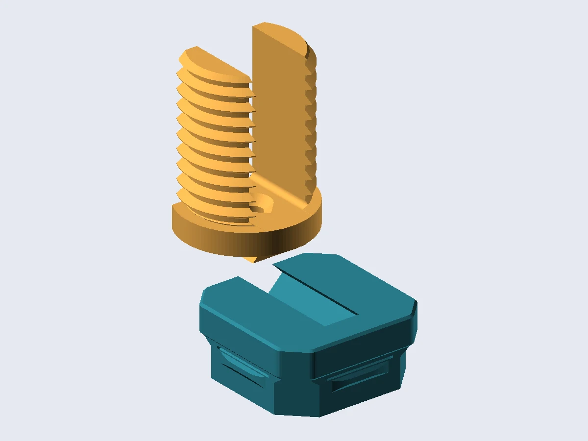

<!-- SPDX-License-Identifier: CC-BY-4.0 -->

# openGrid multipart cable screw clamp

| Part               | STL                   | OpenSCAD                  |
| ------------------ | --------------------- | ------------------------- |
| Threaded fork      | [STL](clamp_fork.stl) | [Source](clamp_fork.scad) |
| Full openGrid snap | [STL](clamp_snap.stl) | [Source](clamp_snap.scad) |

The two posts share one printed saddle, so the ring nut follows a single interrupted thread. The
fork's dovetail slides into the snap from the side. A blind end locates the fork, the flanks of the
dovetail carry pull away from the board, and a recessed M3 screw keeps the fork from sliding back
out. The collar sits on the face of the tile and leaves the standard snap arms free to flex.

## Assembly

1. Slide the fork's dovetail into the open end of the snap socket until it stops.
2. Fit an M3 × 14 mm flat-head screw through the floor of the cable slot into the snap's printed
   pilot. Check that its head is at or below the cable seat and its tip is below the back of the
   snap.
3. Press the assembled snap into a [Full openGrid tile](../OPENGRID.md#full-snap-profile). Lay the
   cable in the slot and start the ring nut by hand.

Use the existing ring nut from Tim's **Cable Clamp for OpenGrid / Underware**. This prototype's
right-hand 2.5 mm thread is modeled independently from measurements of the original clamp and ring.
Check the first printed pair by hand before printing a batch. The ring nut is supplied by the
original project.

## Measure and tune

| Input         | Where to measure                                                      | Caliper |
| ------------- | --------------------------------------------------------------------- | ------- |
| `cable_gap`   | Across the widest cable or bundle that has to pass between the posts  | 6 in    |
| `post_length` | How much height the cable and the ring need together above the saddle | 6 in    |

`thread_radial_clearance` takes material off the male thread crest. Increase it if the ring nut
starts but binds. `slide_clearance` controls the fit along the dovetail. `pilot_d` sets the screw
grip in the printed snap. Size it for the screw and material you use. `saddle_radius` rounds the
corners at the bottom of the cable channel. `shoe_bed_chamfer` gives the dovetail heel room for
first-layer squish.

## Printing

Print both pieces as exported, without supports. The snap goes collar-down so its relief slots open
upward. Its dovetail socket has a 45° roof. The fork has a flat through both posts and the saddle,
with the thread axis parallel to the build plate. That lets the layers run along the posts and
preserves the thread on the sides. Its screw hole has a pointed roof so it can print crosswise. The
steepest downward faces on both parts are 45° from vertical.

Prototype fit and load capacity are untested on physical prints. Try the dovetail, screw, ring nut,
and a spare tile before making a batch.

The snap adapts the [openGrid adhesive snap](../opengrid_adhesive_snap/README.md) from this
repository. The full snap profile is from David D's openGrid and mitufy's CC BY 4.0 library. The
profile retains the gabled relief groove and uses a collar with a gabled dovetail socket for the
fork.
