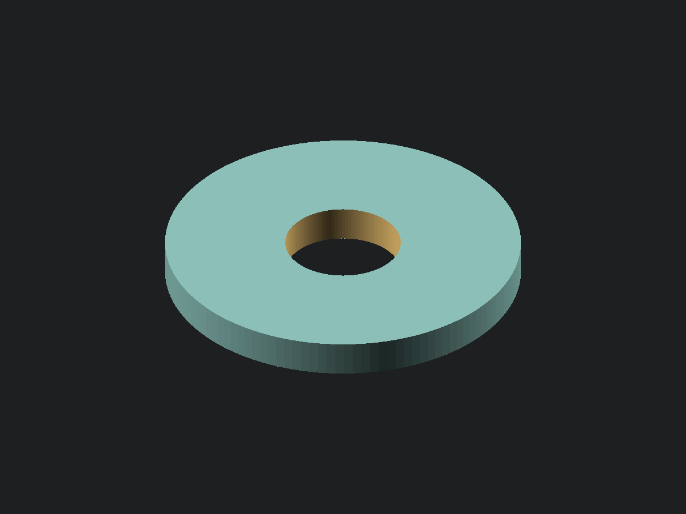

<!-- SPDX-License-Identifier: CC-BY-4.0 -->

# Round washer

[View or download STL](round_washer.stl) · [OpenSCAD source](round_washer.scad)

A flat round washer with a concentric through bore. Set its **inner diameter (ID)**, **outer
diameter (OD)**, and **thickness** directly. All dimensions are in millimetres. The supplied 6.5 mm
ID, 20 mm OD, and 2 mm thickness are example dimensions, not a standard washer size.

## Dimensions and measuring

Measure an existing washer with calipers, or choose the finished dimensions for your application.

| Parameter        | Meaning                               | Default | Measure                         | Caliper |
| ---------------- | ------------------------------------- | ------- | ------------------------------- | ------- |
| `inner_diameter` | Inner diameter of the through bore    | 6.5 mm  | Inside jaws at the bore opening | 6 in    |
| `outer_diameter` | Outer diameter of the washer          | 20 mm   | Outside jaws across the rim     | 6 in    |
| `thickness`      | Axial distance between the flat faces | 2 mm    | Outside jaws on the two faces   | 6 in    |

The inner diameter and thickness must be positive, and the outer diameter must exceed the inner
diameter. Assertions reject values that would close the bore or remove the washer. The source echoes
all three dimensions and the derived radial width of material around the bore:
`(outer_diameter - inner_diameter) / 2`, which is 6.75 mm with the defaults.

## Tuning

`inner_diameter` is the finished model's bore size; no clearance is added automatically. For a
washer that slips over a shaft or screw, measure its largest outside diameter and allow the
clearance your printer and material need. Increase the inner diameter if a trial print binds. Keep
enough radial width around the bore for your application and enough thickness for your chosen layer
height.

`$fn` controls the circular resolution and ships at 128 segments. Both faces are flat and both rims
are square, with no chamfers or countersinks.

## Printing

Print as modelled, with a flat face on the plate and the bore axis vertical. The bore goes all the
way through, so there is no ceiling to bridge. The inner and outer walls are vertical (0° from
vertical), and the only downward-facing surface is the first layer on the plate. No supports are
needed. Either flat face can sit on the plate; leave placement to the slicer.

The example dimensions have not been physically printed or fit-tested.
