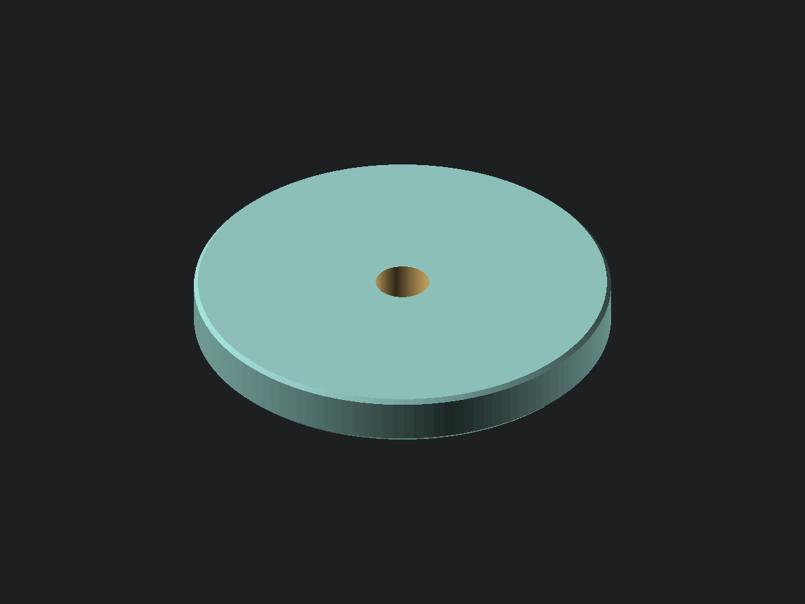

<!-- SPDX-License-Identifier: CC-BY-4.0 -->

# Round washer

[View or download STL](round_washer.stl) · [OpenSCAD source](round_washer.scad)

A flat round washer with a concentric through bore. Set its **inner diameter (ID)**, **outer
diameter (OD)**, and **thickness** directly. All dimensions are in millimetres. The supplied 6.5 mm
ID, 50.8 mm (2 in) OD, and 6 mm thickness are a starting geometry for shelf-support spacers across
approximately 25.4 mm (1 in) wall-panel grooves. The 6.5 mm bore provides nominal clearance for a
6.35 mm (¼ in) screw; verify the printed fit. These are trial dimensions, not a standard washer size
or a structural load rating.

## Dimensions and measuring

Measure an existing washer with calipers, or choose the finished dimensions for your application.

| Parameter        | Meaning                               | Default | Measure                         | Caliper |
| ---------------- | ------------------------------------- | ------- | ------------------------------- | ------- |
| `inner_diameter` | Inner diameter of the through bore    | 6.5 mm  | Inside jaws at the bore opening | 6 in    |
| `outer_diameter` | Outer diameter of the washer          | 50.8 mm | Outside jaws across the rim     | 6 in    |
| `thickness`      | Axial distance between the flat faces | 6 mm    | Outside jaws on the two faces   | 6 in    |

The inner diameter and thickness must be positive, and the outer diameter must exceed the inner
diameter. Assertions reject values that would close the bore or remove the washer. The source echoes
all three dimensions and the derived radial width of material around the bore:
`(outer_diameter - inner_diameter) / 2`, which is 22.15 mm with the defaults. It also echoes the
outer chamfer size and flat bearing diameter, which is 49.8 mm with the defaults.

## Tuning

`inner_diameter` is the finished model's bore size; no clearance is added automatically. For a
washer that slips over a shaft or screw, measure its largest outside diameter and allow the
clearance your printer and material need. Increase the inner diameter if a trial print binds. Keep
enough radial width around the bore for your application and enough thickness for your chosen layer
height.

`edge_chamfer` defaults to 0.5 mm on both outer edges. Its radial run and axial rise use the same
value, keeping the bevel at 45° for every setting. This small edge break improves handling and
appearance while retaining broad, flat bearing faces. The bore stays straight, without a
countersink. Set `edge_chamfer = 0` for square outer edges. Assertions require a nonnegative chamfer
smaller than the radial width and less than half the thickness, preserving flat bearing faces and a
straight section of outer wall.

`$fn` controls the circular resolution and ships at 128 segments. Outer diameter includes the
bevelled rim; the flat bearing diameter is `outer_diameter - 2 * edge_chamfer`.

## Printing

Print as modelled, with a flat face on the plate and the bore axis vertical. The bore goes all the
way through, so there is no ceiling to bridge. The bore and central outer wall are vertical (0° from
vertical). The lower outer bevel is the worst overhang, at 45° from vertical; its angle is fixed by
construction. No supports are needed. Either flat face can sit on the plate; leave placement to the
slicer.

For the shelf-spacer trial, use black ELEGOO PETG-CF, print solid (100% infill), and check the
sliced layers for a fully filled interior. Use dry filament, a wear-resistant nozzle, and the
manufacturer's material profile. Finish screw tightening by hand and stop before visible dishing or
indentation. Keep the same thickness at each mounting point for a consistent standoff, and allow for
that standoff when selecting screw length.

The 6 mm thickness is a starting point for testing across the wall groove, not a verified minimum.
Increased thickness improves bending stiffness but does not eliminate compression creep or loss of
clamping force. Test the worst-positioned mounting point first, inspect for settling after a day and
a week before fully loading the shelves, and continue periodic checks. The screws need sound
anchorage behind the paneling.

These dimensions have not been physically printed, fit-tested, load-tested, or validated for
long-term creep. Mesh checks establish geometry and support-free printability, not shelving
capacity. Regenerate and re-slice any existing local slicer project after this source change.
