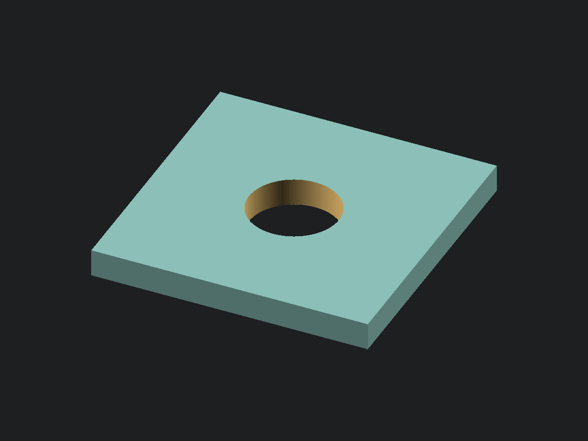

<!-- SPDX-License-Identifier: CC-BY-4.0 -->

# Square washer

[View or download STL](square_washer.stl) · [OpenSCAD source](square_washer.scad)

A flat square washer with a centred round through bore. Set its **inner diameter (ID)**, **side
length**, and **thickness** directly. All dimensions are in millimetres. The supplied 6.5 mm ID, 20
mm side length, and 2 mm thickness are example dimensions, not a standard washer size.

This is the square exterior counterpart to the [round washer](../round_washer/README.md). The bore
stays round, and a single side length sets both exterior dimensions.

## Dimensions and measuring

Measure an existing washer with calipers, or choose the finished dimensions for your application.

| Parameter        | Meaning                                  | Default | Measure                                     | Caliper |
| ---------------- | ---------------------------------------- | ------- | ------------------------------------------- | ------- |
| `inner_diameter` | Inner diameter of the round through bore | 6.5 mm  | Inside jaws at the bore opening             | 6 in    |
| `side_length`    | Side length of the square exterior       | 20 mm   | Outside jaws across opposite straight edges | 6 in    |
| `thickness`      | Axial distance between the flat faces    | 2 mm    | Outside jaws on the two faces               | 6 in    |

Measure the square across opposite straight edges. The inner diameter and thickness must be
positive, and the side length must exceed the inner diameter. Assertions reject values that would
close the bore or break it out through the sides. The source echoes all three dimensions and the
derived minimum width of material between the bore and a straight exterior edge:
`(side_length - inner_diameter) / 2`, which is 6.75 mm with the defaults.

## Tuning

`inner_diameter` is the finished model's bore size; no clearance is added automatically. For a
washer that slips over a shaft or screw, measure its largest outside diameter and allow the
clearance your printer and material need. Increase the inner diameter if a trial print binds. Keep
enough material between the bore and the exterior edges for your application and enough thickness
for your chosen layer height.

`$fn` controls the bore's circular resolution and ships at 128 segments. The exterior has four
straight sides and sharp corners. Both faces are flat, with no chamfers or countersinks.

## Printing

Print as modelled, with a flat face on the plate and the bore axis vertical. The bore goes all the
way through, so there is no ceiling to bridge. The inner and outer walls are vertical (0° from
vertical), and the only downward-facing surface is the first layer on the plate. No supports are
needed. Either flat face can sit on the plate; leave placement to the slicer.

The example dimensions have not been physically printed or fit-tested.
